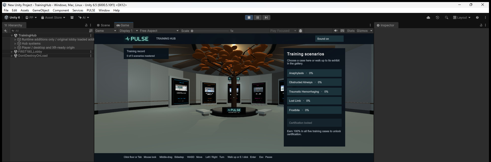

# PULSE

**First Aid in VR** is a Unity practice simulation with five emergency scenarios. Start in the training lobby, practice with ROOK’s written guidance, and earn 100% in each scenario to unlock an unassisted certification run.

## Open the simulation

1. Clone this repository, or pull the latest `main` in your existing clone.
2. In Unity Hub, select **Add → Add project from disk** and choose the [New Unity Project](New%20Unity%20Project) folder inside the clone.
3. Open it with **Unity 6000.5.10f1**. In the Project window, open [Assets/Practice/Scenes/TrainingHub.unity](New%20Unity%20Project/Assets/Practice/Scenes/TrainingHub.unity) and press **Play**.

On desktop, use **WASD** to walk, **Left/Right** to turn, and **Tab** to switch between mouse look and the menu cursor. Walk up to a scenario window or select it to enter.

## Scenario gallery

| Scenario | Setting | Unity Editor screenshot |
| --- | --- | --- |
| Anaphylaxis | Switchback Coffee | [Café](Design/PracticeDevelopment/EnclosedBays/01-Cafe_Anaphylaxis.jpg) |
| Obstructed airways | Relay Hall | [Dining hall](Design/PracticeDevelopment/EnclosedBays/02-Dining_ObstructedAirways.jpg) |
| Traumatic hemorrhaging | Indoor service road | [Roadway drill](Design/PracticeDevelopment/EnclosedBays/03-Road_Hemorrhaging.jpg) |
| Lost limb | Fabrication workshop | [Machine shop](Design/PracticeDevelopment/EnclosedBays/04-Workshop_LostLimb.jpg) |
| Frostbite | Open-air alpine trail with a timber refuge | [Snow biome](Design/PracticeDevelopment/AlpineTrail/Open-air-frostbite.jpg) |

## Project guide

- **Gameplay** · [Unity scenes](New%20Unity%20Project/Assets/Practice/Scenes) and [simulation scripts](New%20Unity%20Project/Assets/Practice/Scripts)
- **Interface** · [Patient panel and silent ROOK correction](Design/PracticeDevelopment/EnclosedBays/06-Silent-ROOK-and-patient-panel.jpg) and [certification results in the spatial panel](Design/PracticeDevelopment/EnclosedBays/07-Spatial-panel-preview.jpg)
- **Development and portfolio** · [Development log](Design/PracticeDevelopment/DEVELOPMENT_LOG.md), [scenery credits](Design/PracticeDevelopment/Room-asset-register.md), and [entry readiness](Design/PracticeDevelopment/2027-entry-readiness.md)
- **Verification** · [Scene and logic checks](Design/PracticeDevelopment/logic-verification.txt) and [Play Mode results](Design/PracticeDevelopment/runtime-verification.txt). Physical headset testing is still pending.
- **Team setup** · [Unity Cloud, Unity CLI and GitHub push checks](docs/unity-workflow.md)
